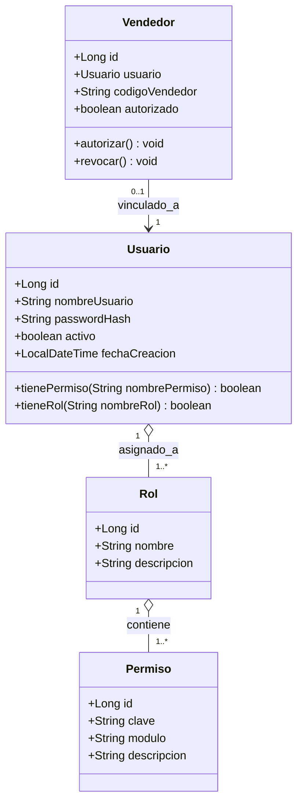

# 📋 PoliMarket - Registro de Pendientes y Mejoras Arquitectónicas

Este documento consolida las oportunidades de mejora, refactorización y evolución funcional y arquitectónica identificadas para las próximas iteraciones del proyecto **PoliMarket**.

---

## 📌 1. Unificación de Catálogo de Productos y Bodega (Frontend y Backend)

### Contexto Actual
Actualmente existen dos vistas y servicios separados para productos:
- **Ventas (Productos Disponibles):** Muestra artículos con existencia mayor a cero.
- **Bodega (Existencias):** Muestra artículos con todas las existencias (incluyendo agotados en cero).

### Oportunidad de Mejora
Ambas vistas representan esencialmente la misma entidad y concepto de negocio. Separarlas genera duplicidad visual y de código tanto en el front como en el back.

### Tareas Pendientes
- [ ] **Unificar en una sola vista/tabla en el Front:** 
  - Consolidar las pestañas de "Productos Disponibles" y "Bodega e Inventario" en un único módulo maestro de **Productos e Inventario**.
- [ ] **Filtros Dinámicos de Estado de Inventario:**
  - `Todos los productos` (inventario general de bodega).
  - `Disponibles` (stock > 0 para catálogo de venta comercial).
  - `Stock Bajo` (ej: < 10 unidades).
  - `Agotados` (stock = 0 con acceso directo al proveedor para reposición).
- [ ] **Unificación del Servicio de Consulta en el Backend:**
  - Diseñar un único endpoint enriquecido con criterios de búsqueda:
    ```http
    GET /api/v1/bodega/productos?estado=DISPONIBLES&termino=teclado
    ```
  - Evitar redundancia entre `ServicioVentas.consultarProductosDisponibles` y `ServicioBodega.consultarExistencias`.

---

## 📌 2. Implementación de Filtros Avanzados en Todas las Tablas

### Contexto Actual
Solo la tabla de administración de Recursos Humanos cuenta actualmente con filtro en tiempo real por nombre de usuario.

### Tareas Pendientes
- [ ] **Tabla de Productos e Inventario:**
  - Filtro por texto en tiempo real (búsqueda por código o nombre del producto).
  - Selector de rango de stock (mínimo / máximo).
- [ ] **Tabla de Clientes Potenciales:**
  - Filtro por razón social o nombre comercial.
  - Filtro por ciudad / sede geográfica.
- [ ] **Tabla de Histórico de Adquisiciones (Consola y Web):**
  - Filtro por nombre de proveedor o código de producto adquirido.

---

## 📌 3. Análisis y Rediseño del Diagrama de Clases: Modelo de Seguridad, Roles y Permisos (RBAC)

### Contexto Actual
En el diseño original del caso de estudio solo se concibió la clase `Vendedor`. Sin embargo, para soportar un sistema computacional real y desacoplado, se requiere separar el concepto de usuario autenticable de sus roles y permisos operativos.

### Necesidades Identificadas
1. **Diferenciación de Perfiles:** Un usuario puede ser exclusivamente **Vendedor**, exclusivamente de **Recursos Humanos** o administrador general.
2. **Permisos Granulares de Almacén:** 
   - ¿Quién puede consultar productos? (Cualquier vendedor autorizado o analista).
   - ¿Quién tiene autorización para **aumentar stock** (abastecimiento/compras)?
   - ¿Quién tiene autorización para **disminuir stock** (despachos/salidas comerciales)?
3. **Permisos de Recursos Humanos:**
   - La gestión de habilitar o revocar autorizaciones de vendedores debe ser exclusiva del rol `RECURSOS_HUMANOS`.

### Propuesta Arquitectónica de Clases (RBAC)



### Matriz de Permisos Sugerida
| Rol | Permisos Sugeridos | Acciones Permitidas |
| :--- | :--- | :--- |
| `RECURSOS_HUMANOS` | `RRHH_GESTION_VENDEDORES`, `RRHH_AUDITORIA` | Autorizar/revocar vendedores, ver nómina y auditoría de accesos. |
| `VENDEDOR` | `VENTAS_CLIENTES_LEER`, `VENTAS_CATALOGO_LEER` | Consultar clientes potenciales y catálogo disponible para ventas. |
| `BODEGUERO / ALMACEN`| `BODEGA_CONSULTA`, `BODEGA_STOCK_INGRESAR`, `BODEGA_STOCK_EGRESAR`, `BODEGA_REPOSICION` | Ver stock completo, aumentar stock (recargar), disminuir stock y solicitar reposición. |
| `ADMINISTRADOR` | `*` (Acceso total) | Gestión de usuarios, roles, catálogo y configuraciones. |

### Tareas Pendientes
- [ ] Crear las entidades de dominio: `Usuario`, `Rol`, `Permiso`.
- [ ] Adaptar los repositorios JPA y tablas en base de datos (`usuarios`, `roles`, `permisos`, `usuarios_roles`, `roles_permisos`).
- [ ] Implementar anotaciones de seguridad en controladores (ej. `@PreAuthorize("hasAuthority('BODEGA_STOCK_INGRESAR')")`).
- [ ] Actualizar el diagrama de clases en el documento de arquitectura del proyecto.

---

## 📌 4. Transformación de Clientes Potenciales a Tabla Corporativa

### Contexto Actual
Actualmente los clientes potenciales se renderizan en una cuadrícula de tarjetas (*cards*).

### Oportunidad de Mejora
Para carteras corporativas y equipos comerciales de alto volumen, una estructura en tabla tabular permite comparar datos de contacto rápidamente, ordenar por columnas y exportar o filtrar sin ocupar tanto espacio vertical.

### Tareas Pendientes
- [ ] Reemplazar la vista en cuadrícula de tarjetas (`.grid-cards`) por una tabla estructurada (`<table>`).
- [ ] Definir columnas de la tabla:
  - **ID Cliente**
  - **Razón Social / Empresa**
  - **Correo Electrónico Corporativo** (con enlace `mailto:`)
  - **Teléfono / Línea Directa** (con enlace `tel:`)
  - **Ciudad / Región** (con badge visual de sede)
  - **Acciones Rápidas** (Contactar, copiar datos).
- [ ] Agregar buscador/filtro en vivo por Razón Social y selector por Ciudad.

---

## 📅 Resumen de Prioridades para el Próximo Sprint

| Prioridad | Tarea / Característica | Capa Afectada |
| :---: | :--- | :--- |
| 🔴 **Alta** | Rediseño de Clases para RBAC (Usuarios, Roles y Permisos) | Dominio, Persistencia y Seguridad |
| 🟡 **Media** | Unificación de Tabla y Servicio de Productos/Bodega con Filtros | Frontend (Web) y Backend (Servicios/Controllers) |
| 🟡 **Media** | Reestructuración de Clientes Potenciales a Tabla con Búsqueda | Frontend (Web) |
| 🟢 **Baja** | Filtros avanzados en histórico de adquisiciones de consola y web | Frontend y Cliente Consola |
